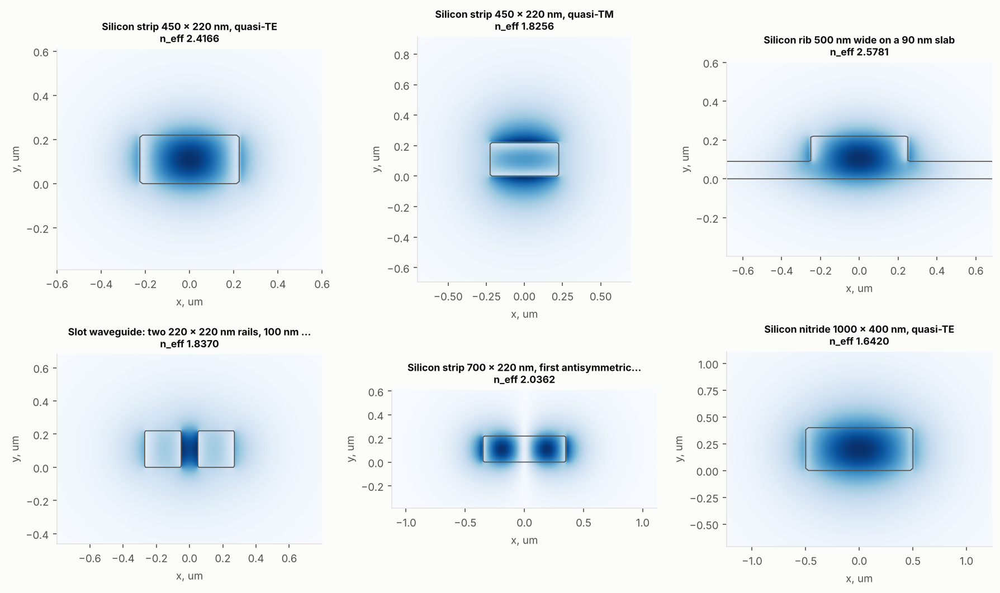

# ModeGrid

A semi-vectorial finite-difference mode solver for dielectric waveguides in C++17, with no dependencies: banded LU, shift-and-invert iteration, mirror planes, quasi-TE, quasi-TM and scalar fields, group index, confinement, mode area and the supermodes of directional couplers.

The repository is also a library of 95 waveguide cross-sections. Each file states in its first lines what it shows and what it is checked against, and carries the result as machine-checked expectations. Every structure is solved a second time by an independent SciPy implementation.

## What is inside

| Part | Where | Content |
|---|---|---|
| Grid | `cpp/src/grid.cpp`, `structure.cpp` | cells with one permittivity each, rectangles painted in order, area-weighted cut cells |
| Operator | `wave_operator.cpp` | semi-vectorial and scalar operators, metallic walls, even and odd mirrors |
| Linear algebra | `banded.cpp`, `eigen.cpp` | banded LU, shift-and-invert iteration for the largest eigenvalue |
| Modes | `mode.cpp` | effective index, guidance test against the cladding or slab index, confinement, area, sizes |
| Analysis | `analysis.cpp` | group index by wavelength difference, coupler supermodes and coupling length |
| Files | `parser.cpp`, `expect.cpp` | text format, thirteen kinds of expectation |
| Library | `cases/*.wg` | 95 structures in eleven families |
| Reference | `src/modegrid/reference.py` | the same grids assembled and solved independently with SciPy; exact slab indices |
| Results | `reports/cases/*.json`, `reports/figures/cases/*.png` | metrics, checks and mode profile of every structure |

179 C++ checks; pytest runs every structure of the library as its own test.

## Results

95 structures, 848,514 cells solved, 746 checks, all passing. Full tables in `reports/report.md`.

| Family | Structures | What is verified |
|---|---|---|
| Silicon strips | 22 | index, group index, confinement and area for widths of 300 to 1000 nm and thicknesses of 180 to 400 nm, TE and TM; bounds from the slab index |
| Rib waveguides | 7 | index between the indices of the thin and the full slab; guidance judged against the slab mode |
| Silicon nitride | 8 | low-contrast guides, both polarisations |
| Wavelength | 6 | 1.27 to 1.60 um |
| Antisymmetric mode | 6 | cut-off of the first higher-order mode against width |
| Directional couplers | 10 | supermode indices and coupling length for strips, ribs and TM |
| Slot waveguides | 3 | field maximum in the low-index slot |
| Slab limit | 6 | exact slab index reproduced within 5e-5 (nitride) to 1.9e-3 (silicon TM) on a 10 nm grid |
| Grid convergence | 18 | six aligned grids from 40 to 10 nm, three grids that cut the walls |
| Scalar field | 3 | the scalar index against the two polarisations |
| Window and mirror | 6 | insensitivity to the window; whole structure against mirrored half |

Agreement between the C++ solver and the SciPy reference over the whole library: effective index to 5e-11, group index to 5e-9, field to 4e-6 of its peak.



## Four things the solver makes visible

1. **Polarisation matters more than anything else in thin silicon.** For a 450 x 220 nm strip the scalar index is 2.58, quasi-TE 2.42, quasi-TM 1.83. The scalar equation is not a usable approximation at this contrast; in nitride the three values lie within 0.09.
2. **The second mode appears near 500 nm.** With an odd mirror a 400 nm strip gives only a box mode below the cladding index; at 500 nm the antisymmetric mode is just guided (1.455 against 1.444), at 600 nm it is at 1.77.
3. **Coupling falls by 1/e every 116 nm of gap.** Two 450 nm strips exchange power in 9.5 um at a 100 nm gap, 23 um at 200 nm and 127 um at 400 nm; the logarithm of the splitting is a straight line in the gap to within 2%. TM couples over 6.6 um at 200 nm.
4. **A slot holds the field outside the silicon.** With two 220 nm rails 100 nm apart, only 16% of the squared field is in the silicon; the peak sits in the slot, as the interface condition requires.

## Reading the numbers

- The method is semi-vectorial. For silicon strips near the single-mode width, values commonly quoted from full-vector solvers are lower: about 2.35 against 2.42 here for the quasi-TE mode of a 450 x 220 nm strip, and a group index near 4.2 to 4.3 against 4.10. That comparison is from the literature, not made in this repository, and the difference is the approximation, not the grid. Treat silicon-strip indices as good to a few percent; nitride and rib guides are closer.
- Grid error is first order. On the 20 to 25 nm grids used for most of the library the index is 0.006 (TE) to 0.009 (TM) above the extrapolated value. Trends, differences and coupling lengths are more reliable than absolute indices.
- Cells cut by a wall take an area-weighted permittivity. Three grids that cut the walls of the same strip give 2.411, 2.414 and 2.418 (TE) and 1.827 to 1.856 (TM): usable, not converged. Choose cell sizes that divide the waveguide dimensions.
- Only the mode of highest index in each symmetry class is found: the fundamental mode, and the first antisymmetric one through an odd mirror. There is no mirror in y, so no access to modes that are antisymmetric vertically.
- The walls are metallic and there are no absorbing layers: no leaky modes, no bend loss, no substrate leakage. A mode reported as not guided is a mode of the box and its numbers mean nothing beyond that.
- Confinement is the share of the squared dominant field in the highest-index material. It is not the power confinement factor of the literature and is far smaller for TM modes (0.17 for the 450 nm strip).
- The effective index method agrees with the solver to 0.004 for strips of 400 nm and wider. Both neglect the same hybrid-field effects, so this is a consistency check between two approximations, not evidence of accuracy.
- Materials use linear dispersion around 1.55 um; O-band structures give indices as numbers, and their group index then lacks material dispersion.
- The expectations in the structure files and the recomputation in the report come from the same independent implementation of the same discretisation. They verify the linear algebra and the bookkeeping. The only comparison with an exact result is the slab limit.
- The per-structure result files and figures are generated by `make run`; they are stored so that the library can be browsed without building anything.

## Run it

```
pip install -e ".[dev]"
make build      # g++ -O2 -std=c++17, solver and its tests
make test       # C++ checks, then pytest (every structure is a test)
make run        # solves the library, writes reports/ (about a minute)
```

One structure:

```
cpp/build/modegrid check cases/rib_slab90.wg
python scripts/solve.py cases/coupler_te_gap200.wg
python scripts/plot_mode.py cases/slot_gap100.wg mode.png
python scripts/compare_reference.py cases/strip_tm_w450.wg
python scripts/width_sweep.py 0.3 tm
```

A structure file:

```
# Even and odd supermodes; the power crosses over in lambda / (2 (n_even - n_odd)).
title Two 450 x 220 nm strips, 200 nm apart, quasi-TE
grid dx=0.025 dy=0.02
window width=4.0 ymin=-1.0 ymax=1.22
rect si 0.1 0.55 0 0.22
rect si -0.55 -0.1 0 0.22
field te
coupler

expect n_even 2.434360981 2e-8
expect coupling_length 23.198237421 1e-4
```

From C++:

```cpp
#include "modegrid/analysis.hpp"
#include "modegrid/parser.hpp"

const mg::Structure s = mg::parse_structure_text("grid dx=0.025 dy=0.02\nrect si -0.25 0.25 0 0.22\nsymmetry even\n");
const mg::Analysis a = mg::analyse(s);
std::printf("n_eff %.4f, group index %.3f, area %.3f um2\n", a.mode.n_eff, a.group_index, a.shape.area);
```

## Layout

```
cpp/include/modegrid/   headers: grid, structure, material, wave_operator, banded, eigen, mode, analysis, parser, expect
cpp/src/                implementation and the command line program
cpp/tests/              one test file per module, a small check harness
cases/                  95 structures, each with its description and expectations
src/modegrid/           Python driver, independent reference, comparison, studies, report and figures
docs/                   structure file reference, method and accuracy
reports/                report, validation table, per-structure results and mode profiles
```

## Author

Amir Masominia. PhD in physics (Université Paris-Saclay); postdoctoral researcher working on machine-learning surrogate models, numerical simulation and automated measurement pipelines.

MIT licence.
